# Smart Manufacturing Predictive Maintenance — End-to-End DevSecMLOps Project

Predicts whether an industrial machine is likely to fail in its next operational cycle from sensor
readings, and turns that prediction into a maintenance decision: **failure probability, health
score, risk level, recommended action, urgency, and the sensor readings driving the risk.**

The project covers the full lifecycle: data generation → validation → EDA → feature engineering →
model comparison + tuning → MLflow tracking and registry → REST API (real-time + batch) → Docker →
CI/CD with security scanning → monitoring → drift detection → automated retraining → alerts → tests.

---

## 1. Business problem

Unplanned machine breakdowns cause downtime, defective output, expensive emergency repairs and
spare-part shortages. Fixed maintenance schedules either service machines too early (waste) or too
late (failure). This system watches sensor data continuously and tells the maintenance team
**which machine needs attention, how urgently, and why**.

## 2. Architecture

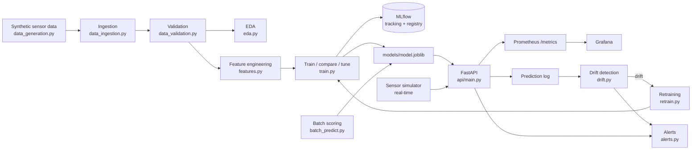

## Screenshots

**Overview:** model quality, model comparison and failure drivers
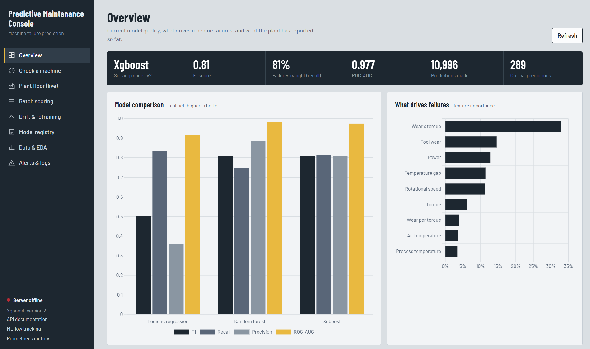

**Check a machine:** live health gauge, risk level, recommended action and main risk drivers
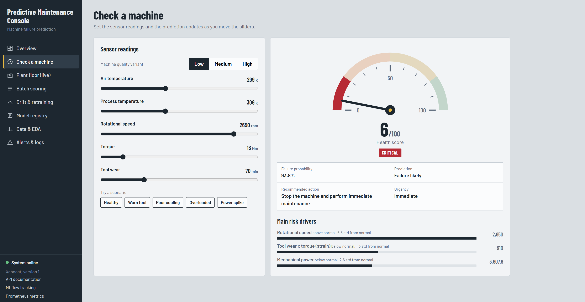

**Plant floor:** simulated machines streaming sensor data in real time, with automatic predictive maintenance
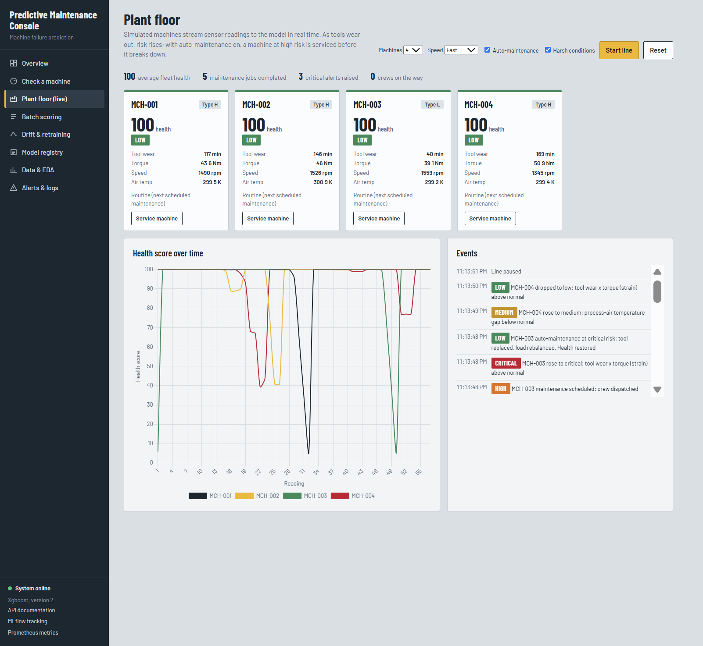

**Drift & retraining:** per-sensor drift detection and champion vs challenger retraining
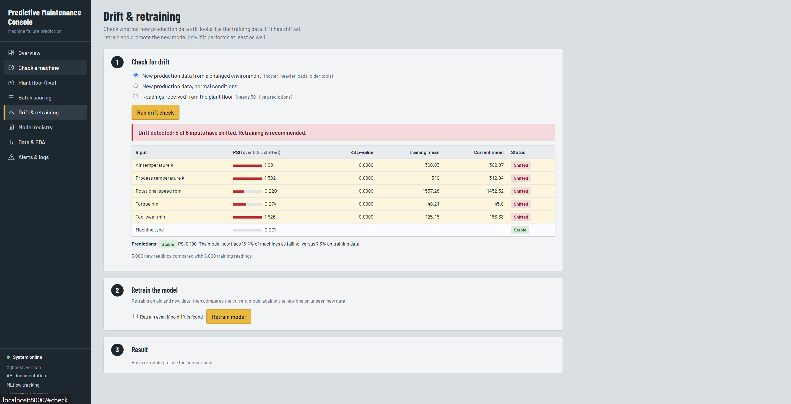

**Batch scoring on the real AI4I 2020 dataset**
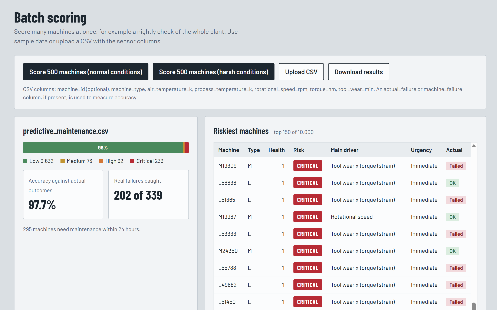

**Model registry:** every model version in MLflow, with the serving champion
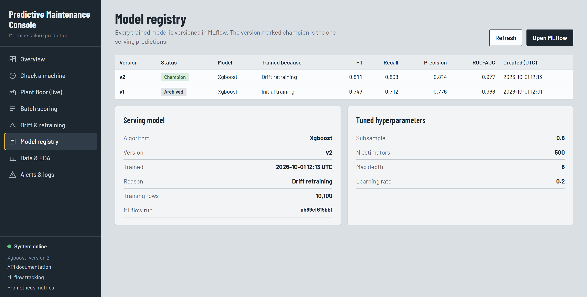

**Data & EDA:** dataset statistics and validation checks
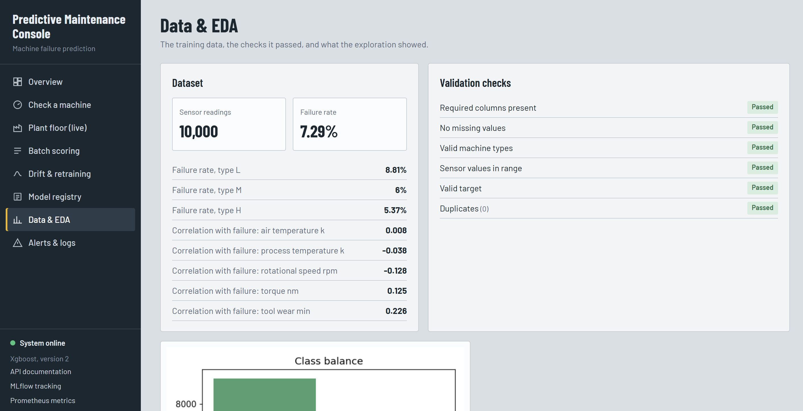

**Alerts & logs:** critical machines, drift and retraining alerts, recent predictions
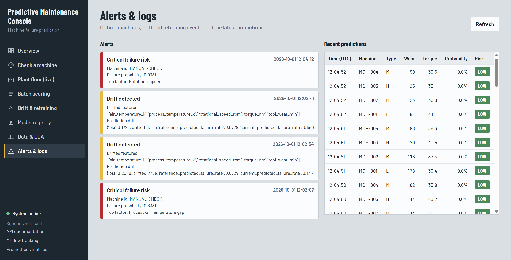

### EDA and evaluation
| Class balance | Failure rate by machine type |
|---|---|
| 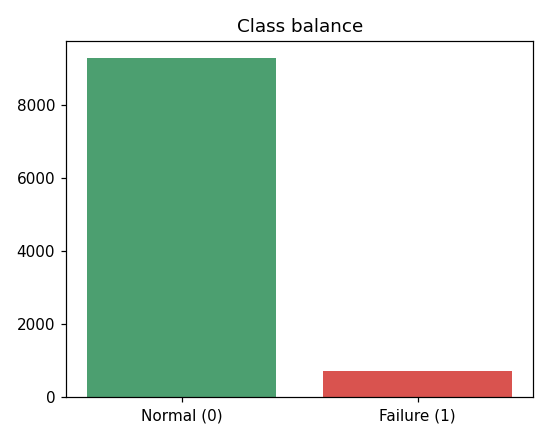 | 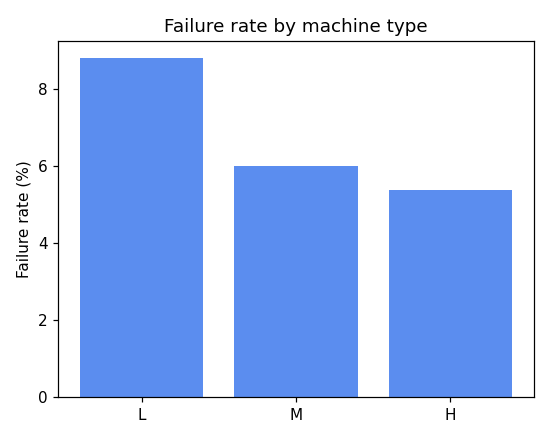 |
| **Correlation heatmap** | **Confusion matrix (test set)** |
| 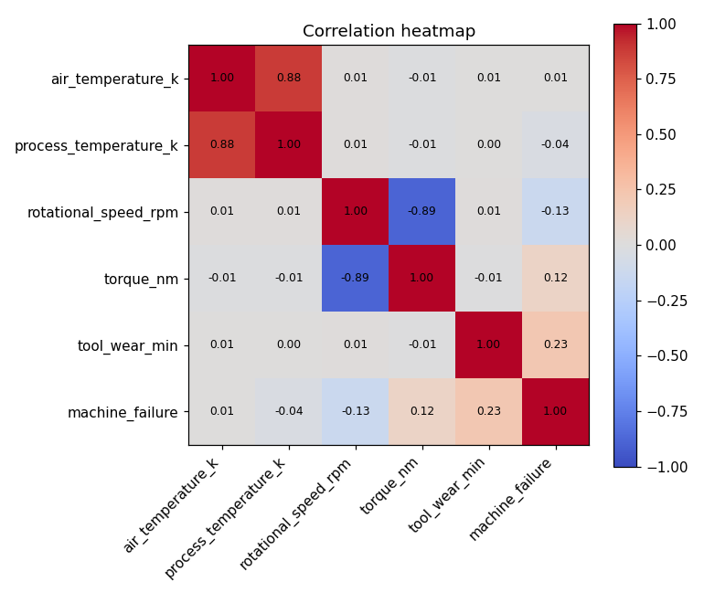 | 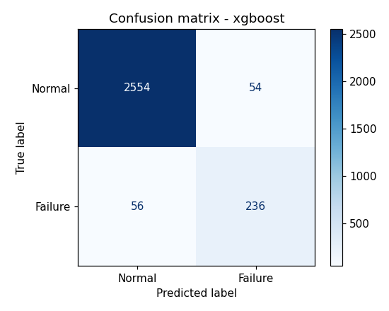 |

**Sensor distributions, normal vs failing machines**
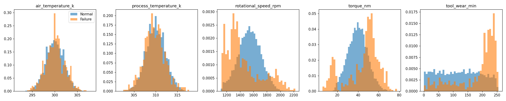

## 3. Tech stack

| Area | Tool |
|---|---|
| ML | scikit-learn, XGBoost, pandas, NumPy |
| Experiment tracking, versioning, registry | MLflow (SQLite backend) |
| API | FastAPI + Pydantic validation, Uvicorn |
| Drift detection | PSI + Kolmogorov–Smirnov test (SciPy) |
| Containers | Docker (multi-stage, non-root), Docker Compose |
| Infrastructure config | Docker Compose, Kubernetes manifest, Prometheus config |
| Monitoring | Prometheus + Grafana (auto-provisioned dashboard) |
| CI/CD | GitHub Actions (CI/CD + scheduled retraining) |
| Security | Bandit (SAST), pip-audit (dependencies), Gitleaks (secrets), Trivy (container) |
| Testing | pytest, pytest-cov, FastAPI TestClient |
| Linting | Ruff |

## 4. Project structure

```
predictive-maintenance/
├── config.yaml                 # all paths, thresholds and settings in one place
├── src/
│   ├── utils.py                # config loader, logging, column names
│   ├── data_generation.py      # synthetic sensor data (AI4I 2020 style failure physics)
│   ├── data_ingestion.py       # load, clean, stratified train/test split
│   ├── data_validation.py      # schema, nulls, sensor ranges, categories, target checks
│   ├── eda.py                  # charts + summary to reports/
│   ├── features.py             # feature engineering + preprocessing pipeline
│   ├── train.py                # compare, tune, evaluate, MLflow log + register
│   ├── pipeline.py             # runs everything end to end
│   ├── predict.py              # probability -> health score, risk, action, top factors
│   ├── drift.py                # sensor drift + prediction drift
│   ├── retrain.py              # drift-triggered retraining (champion vs challenger)
│   └── alerts.py               # alert log + optional webhook
├── api/
│   ├── main.py                 # FastAPI service + web app endpoints
│   ├── jobs.py                 # background training / retraining jobs
│   └── static/index.html       # the web app (single page)
├── run.py, start.bat           # one-click launcher
├── scripts/
│   ├── simulate_stream.py      # real-time sensor simulator
│   └── batch_predict.py        # offline batch scoring of a CSV
├── tests/                      # 28 tests: data, model, drift, API, web app, security
├── monitoring/                 # Prometheus config + alert rules, Grafana dashboard
├── docs/images/                # screenshots and charts used in this README
├── k8s/deployment.yaml         # Kubernetes deployment + service
├── .github/workflows/          # ci.yml (CI/CD) + retrain.yml (weekly retraining)
├── Dockerfile, docker-compose.yml
└── requirements.txt, requirements-dev.txt
```

Folders `data/`, `models/`, `mlruns/`, `logs/`, `reports/` are **generated** when you run the
pipeline and are git-ignored.

## 5. Quick start (Windows, VS Code)

Requires **Python 3.11 or 3.12** (`python --version`).

**Easiest:** double-click **`start.bat`** in the project folder. The first time, it creates the
virtual environment and installs everything (a few minutes); after that it starts instantly.

**Or from the VS Code terminal** (`` Ctrl+` ``), in the project folder:
```powershell
python -m venv .venv
.venv\Scripts\Activate.ps1
pip install -r requirements-dev.txt
python run.py
```
If PowerShell blocks the activate script, run once:
`Set-ExecutionPolicy -Scope CurrentUser RemoteSigned`. On macOS / Linux use
`source .venv/bin/activate`.

`run.py` starts the app and MLflow and **opens http://localhost:8000 in your browser**. The first
time, the app shows **Train model**; click it and watch the pipeline run live. Press `Ctrl+C` in the
terminal to stop.

## 6. Using the app

Everything runs from the browser. No more terminal commands are needed.

| Page | What you can do |
|---|---|
| **Overview** | Model quality (F1, recall, ROC-AUC), model comparison chart, failure drivers, prediction mix, last drift check and retraining |
| **Check a machine** | Move sensor sliders or pick a scenario (healthy, worn tool, poor cooling, overloaded, power spike) and see the health gauge, risk level, action, urgency and main risk drivers update instantly |
| **Plant floor (live)** | Start a production line of simulated machines streaming readings in real time. Tools wear out, health falls and risk rises. With **auto-maintenance** on, a machine at high risk gets a crew dispatched and is serviced before it breaks down, restoring its health. Fleet stats show average health, maintenance jobs and critical alerts. Toggle **harsh conditions** to cause drift, or untick auto-maintenance to see what happens without it |
| **Batch scoring** | Score 500 machines at once or upload a CSV, including the original AI4I 2020 dataset from UCI or Kaggle as-is; see risk mix, accuracy against actual outcomes, riskiest machines, and download the results |
| **Drift & retraining** | Run a drift check (PSI + KS per sensor, prediction drift), then retrain with a live log; the new model is promoted only if it is at least as good |
| **Model registry** | All MLflow model versions, which one is champion, metrics and tuned hyperparameters; link to the MLflow UI |
| **Data & EDA** | Dataset stats, validation checks, EDA charts and the confusion matrix |
| **Alerts & logs** | Critical machines, drift and retraining alerts, and the latest predictions |

The MLflow UI (http://localhost:5000) takes about 30 seconds to come up after starting.

### Command-line equivalents (optional, also used by CI)
```bash
python -m src.pipeline                                   # train
uvicorn api.main:app --reload                            # app + API only
python -m scripts.simulate_stream                        # terminal simulator
python -m src.data_generation --drift --n 3000           # new drifted data
python -m scripts.batch_predict --input data/raw/new_sensor_data.csv
python -m src.drift                                      # drift check
python -m src.retrain                                    # drift-triggered retraining
pytest -v --cov=src --cov=api                            # tests
ruff check . ; bandit -r src api scripts run.py -ll ; pip-audit -r requirements.txt
```

### Full stack with Docker (needs Docker Desktop)
```bash
copy .env.example .env          # macOS/Linux: cp .env.example .env  (then edit values)
docker compose up --build
```
| Service | URL |
|---|---|
| Web app | http://localhost:8000 |
| MLflow | http://localhost:5000 |
| Prometheus | http://localhost:9090 (Alerts tab shows alert rules) |
| Grafana | http://localhost:3000 (admin / password from `.env`) → *Predictive Maintenance – Overview* |

## 7. API

Raw API docs (Swagger) are at http://localhost:8000/docs. The web app uses the same endpoints plus
`/api/...` helpers (status, overview, registry, alerts, drift, background training jobs).

| Method | Endpoint | Purpose |
|---|---|---|
| GET | `/health` | Liveness / readiness check |
| GET | `/model/info` | Model name, version, metrics, feature importance |
| POST | `/predict` | Real-time prediction for one reading |
| POST | `/predict/batch` | Up to 1,000 readings at once |
| GET | `/drift` | Drift check on readings the API has received |
| POST | `/model/reload` | Hot-reload the model after retraining |
| GET | `/metrics/` | Prometheus metrics |

**Example request**
```json
POST /predict
{
  "machine_id": "M-101",
  "machine_type": "L",
  "air_temperature_k": 302.0,
  "process_temperature_k": 310.5,
  "rotational_speed_rpm": 1250,
  "torque_nm": 65.0,
  "tool_wear_min": 230
}
```

**Example response (shape)**
```json
{
  "machine_failure": 1,
  "failure_probability": 0.97,
  "health_score": 3.0,
  "risk_level": "CRITICAL",
  "recommended_action": "Stop the machine and perform immediate maintenance",
  "maintenance_urgency": "Immediate",
  "top_contributing_factors": [
    {"feature": "Tool wear x torque (strain)", "value": 14950.0, "deviation": "above normal", "z_score": 3.1, "impact_score": 1.2}
  ],
  "model_version": 1,
  "machine_id": "M-101"
}
```

## 8. Data

Synthetic data modelled on the public **AI4I 2020 Predictive Maintenance** dataset (UCI). 10,000
readings, ~7% failures. Columns: `machine_type` (L/M/H), `air_temperature_k`,
`process_temperature_k`, `rotational_speed_rpm`, `torque_nm`, `tool_wear_min`, target
`machine_failure`.

A machine fails if any physical failure mode occurs:

| Mode | Rule |
|---|---|
| Tool wear failure | tool wear 200–240 min (random chance) |
| Heat dissipation failure | process–air temperature gap < 8.6 K **and** speed < 1380 rpm |
| Power failure | power < 3,500 W or > 9,000 W |
| Overstrain failure | tool wear × torque above limit (11k / 12k / 13k for L / M / H) |
| Random failure | 0.1% |

Failures are decided on true values, then sensor noise is added, so the problem is realistic and
not perfectly separable. `--drift` generates a changed environment (+3 K hotter, +15% torque,
more worn tools).

## 9. Feature engineering

| Feature | Formula | Why |
|---|---|---|
| `temp_diff_k` | process temp − air temp | heat dissipation problems |
| `power_w` | torque × rpm × 2π / 60 | power failures |
| `wear_strain` | tool wear × torque | overstrain failures |
| `wear_per_torque` | tool wear / torque | wear relative to load |

Feature engineering, scaling and one-hot encoding live inside **one sklearn Pipeline** with the
model, so training and serving apply identical transformations.

## 10. Model results

Class imbalance is handled with `class_weight="balanced"` (LR, RF) and `scale_pos_weight` (XGBoost).
Models are selected on **F1** (not accuracy: a model that always says "no failure" scores 93%
accuracy and is useless).

| Model | Test F1 | Recall | Precision | ROC-AUC |
|---|---|---|---|---|
| Logistic Regression | ~0.40 | ~0.78 | ~0.27 | ~0.88 |
| Random Forest | ~0.69 | ~0.58 | ~0.86 | ~0.97 |
| **XGBoost (tuned, selected)** | **~0.73** | **~0.69** | **~0.77** | **~0.97** |

Exact numbers for your run are in `reports/model_comparison.json`, `reports/classification_report.txt`
and MLflow.

### Validation on real data

The model was trained only on synthetic data, then tested on the real
**AI4I 2020 Predictive Maintenance dataset** (10,000 machines, 339 real failures),
which it had never seen:

| Metric | Synthetic test set | Real AI4I 2020 data |
|---|---|---|
| F1 | ~0.73 | ~0.64 |
| Recall (failures caught) | ~69% | 60% (202 of 339) |
| Precision | ~77% | ~68% |

Accuracy on the real data was 97.7%, but only 3.4% of those machines failed, so a model that
always predicts "no failure" would already score 96.6%. Recall and F1 are the meaningful numbers.
The result shows the synthetic data captures real failure behaviour. The most common risk driver
on real data, tool wear × torque, matches the overstrain failure mode documented for the dataset.

## 11. Business outputs

| Failure probability | Risk level | Action | Urgency |
|---|---|---|---|
| < 0.20 | LOW | Normal operation | Routine |
| 0.20 – 0.50 | MEDIUM | Preventive inspection | Within 7 days |
| 0.50 – 0.80 | HIGH | Plan maintenance, prepare spares | Within 24 hours |
| ≥ 0.80 | CRITICAL | Stop machine, immediate maintenance | Immediate |

**Health score** = 100 × (1 − failure probability).
**Top contributing factors** = for each sensor/feature, |z-score vs training data| × model feature
importance; the top 3 are returned.

## 12. Monitoring, drift and retraining

**Application monitoring:** Prometheus scrapes `/metrics/` (request count, latency, errors, predictions
by risk level, probability distribution, model version). Grafana shows them on an auto-loaded
dashboard. `monitoring/alert_rules.yml` defines alerts: API down, error rate > 5%, p95 latency
> 500 ms, spike in CRITICAL machines.

**Model monitoring:** every prediction is logged to `logs/prediction_log.csv`.

**Live alarms (plant floor):** the risk level is based on a rolling average of the last 3
predictions per machine. Alarms escalate immediately but only clear after two readings in a row,
so a single noisy sensor reading can't trigger or clear an alarm. Critical-risk alerts are
de-duplicated per machine (at most one every 2 minutes).

**Predictive maintenance loop:** when a machine reaches HIGH risk, a maintenance crew is
dispatched automatically and the machine is serviced before it fails; CRITICAL machines get
emergency maintenance on the next reading.

**Sensor drift:** per feature, PSI (> 0.2 = drift) and KS test. Dataset drift if > 30% of features
drift.
**Prediction drift:** PSI on predicted failure probabilities vs training baseline.

**Automated retraining (champion vs challenger):**
1. Drift check on new data → no drift = stop.
2. Validate new data, retrain on old + new data (full comparison + tuning).
3. Score both old and new model on fresh unseen data.
4. Promote the new model (MLflow `@champion` alias) only if it is not worse; otherwise roll back.
5. Alert either way.

Runs on demand (`python -m src.retrain`) and weekly via `.github/workflows/retrain.yml`.

**Alerts** go to `logs/alerts.jsonl` and, if `ALERT_WEBHOOK_URL` is set (Slack / Discord / Teams
incoming webhook), to that channel: `CRITICAL_FAILURE_RISK`, `DRIFT_DETECTED`, `MODEL_RETRAINED`,
`RETRAINING_REJECTED`.

## 13. CI/CD and security (DevSec)

`.github/workflows/ci.yml` runs on every push / PR:

1. **test** — Ruff lint → train pipeline → pytest with coverage (includes a model quality gate:
   F1 ≥ 0.5, ROC-AUC ≥ 0.85).
2. **security** — Bandit static analysis (blocking), pip-audit dependency CVEs (report only),
   Gitleaks secret scanning over full git history.
3. **docker** — build image → Trivy container vulnerability scan → smoke test (`/health` +
   `/predict`) → push to GitHub Container Registry (`ghcr.io/<you>/predictive-maintenance`) on `main`.

Security built into the application:
- Strict Pydantic input validation (types, allowed categories, physical sensor ranges) → HTTP 422
- Optional API key (`X-API-Key`) with constant-time comparison
- Batch size limit (1,000)
- Docker: multi-stage build, non-root user, `no-new-privileges`
- Kubernetes: non-root, dropped capabilities, no privilege escalation, resource limits, secrets via
  `Secret`
- Secrets only from environment variables; `.env` is git-ignored
- MLflow models saved with **skops** with an explicit allow-list of trusted types (safer than pickle)
- Webhook alerts only over HTTPS

## 14. Pushing to GitHub

```bash
git init
git add .
git commit -m "Predictive maintenance DevSecMLOps project"
git branch -M main
git remote add origin https://github.com/Abhiready/predictive-maintenance-devsecmlops.git
git push -u origin main
```
Then open the **Actions** tab to watch the pipeline. The retraining workflow can be started
manually from **Actions → Scheduled retraining → Run workflow**.

## 15. Lifecycle coverage

| # | Requirement | Where |
|---|---|---|
| 1–2 | Dataset / synthetic data generation | `src/data_generation.py` |
| 3 | Data ingestion | `src/data_ingestion.py` |
| 4 | Data validation | `src/data_validation.py` |
| 5 | EDA | `src/eda.py` → `reports/figures/` |
| 6–7 | Preprocessing, feature engineering | `src/features.py` |
| 8–11 | Training, comparison, tuning, evaluation | `src/train.py` |
| 12–14 | Experiment tracking, versioning, registry | MLflow in `src/train.py` |
| 15 | REST API + web app | `api/main.py`, `api/static/index.html` |
| 16 | Batch prediction | `scripts/batch_predict.py`, `/predict/batch` |
| 17 | Real-time prediction | `/predict`, `scripts/simulate_stream.py` |
| 18 | Docker | `Dockerfile`, `docker-compose.yml` |
| 19 | CI/CD | `.github/workflows/ci.yml` |
| 20 | Security scanning | Bandit, pip-audit, Gitleaks, Trivy in CI |
| 21 | Infrastructure configuration | `docker-compose.yml`, `k8s/`, `monitoring/` |
| 22 | Application monitoring | Prometheus metrics + Grafana |
| 23 | Model monitoring | prediction log, `/model/info`, risk-level metrics |
| 24–25 | Sensor & prediction drift | `src/drift.py` |
| 26 | Automated retraining | `src/retrain.py`, `.github/workflows/retrain.yml` |
| 27 | Logging | `src/utils.py` → `logs/app.log` |
| 28 | Alert generation | `src/alerts.py`, `monitoring/alert_rules.yml` |
| 29 | Testing | `tests/` |

## 16. Troubleshooting

| Problem | Fix |
|---|---|
| `ModuleNotFoundError: src` | Run from the project root and use `python -m ...` |
| App shows "Train model" | No model yet: click it (or run `python -m src.pipeline`) |
| MLflow link doesn't open | Wait ~30 s after starting; it only runs when started via `run.py` or Docker |
| MLflow UI is empty | Start it from the project root with `--backend-store-uri sqlite:///mlflow.db` |
| Want to start fresh | Delete `data/ models/ mlruns/ mlflow.db logs/ reports/` and rerun the pipeline |
| Port already in use | Change `--port`, or stop the other process |